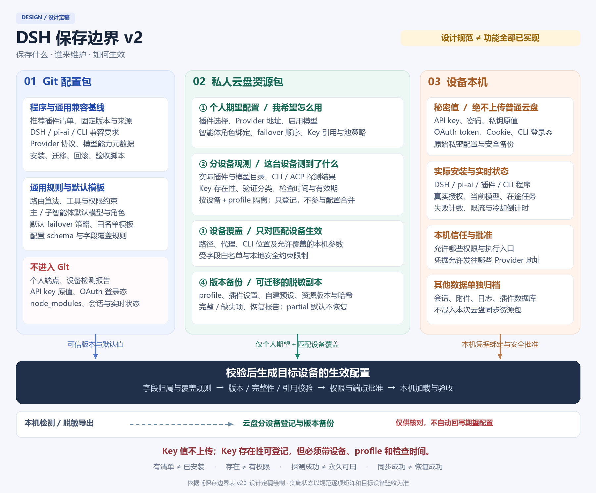

# DSH 保存边界表 v2（历史方案）

> **已被[保存边界表 v3](storage-boundaries-v3.md)替代。** 用户目标已收敛为“源设备一键完整备份、目标设备按选定快照一键重建”。本文长期维护云盘个人期望配置的分工与下方三栏图仅供追溯，不再作为当前实施依据。秘密本机、Key存在性登记、兼容和安全验收原则由v3继承。

- 规范版本：2.0.0
- 状态：**已被v3替代的历史设计；不是已实现、已部署或已发布功能声明**。
- 定稿日期：2026-10-31
- 适用范围：DSH 配置包、云盘资源包、本机配置及恢复工具。
- 复核依据：Kimi K3 与 Opus 5 独立挑战、主控裁决及旧模型目录隔离反例。
- 本次交付：仅文档和导航；不升级程序、不修改 profile、不更新云盘、不提交或发布版本。

> Git 管程序、通用兼容基线和默认模板；云盘管个人配置意图、分设备登记、设备覆盖和脱敏版本备份；本机管秘密值、信任批准、程序本体和实时状态。
>
> **“保存了清单”“检测到存在”“真实调用成功”“可以恢复”是四件不同的事，不能互相替代。**

## 保存边界总览图



[可编辑 SVG 原图](assets/storage-boundaries-v2.svg)。实线表示允许的配置输入，虚线表示脱敏登记/备份；设备观测不参与配置合并。图为设计说明，不表示全部功能已实现。

## 1. 使用口径与唯一权威

修改备份范围、Provider、模型、智能体路由、云盘资源包或恢复流程前，按第 3 节 ID 查归属。新增字段必须声明 owner、隐私等级、合并操作、适用设备/profile、兼容要求和恢复测试。

- **基线**：Git 发布者维护的程序能力、兼容性规则及默认值。
- **期望态 desired**：用户希望启用哪些插件、模型及路由；云盘个人配置是其权威来源。
- **观测态 observed**：某设备某次检测到的事实；只能生成报告，不能自动写回期望态。
- **生效态 effective**：基线、期望态和允许的设备覆盖经过安全校验后，在目标设备实际加载的结果；本机生成，不手工作为第四份配置维护。
- 每个逻辑设置只有一个用户意图 owner；Git 默认值和本机生成副本不是第二个可独立编辑的 owner。设备专属 owner 仅能修改明确列出的本机字段。
- Git 不是天然信任根。安装固定可信发布版本；云盘也不是程序分发或任意代码执行入口。

## 2. 图例与实施状态

| 标记 | 含义 |
| --- | --- |
| ✅ | 在该位置权威保存该行所定义的数据，不表示其他数据也被收录 |
| △ | 默认模板、版本引用、派生副本或脱敏快照；不是另一份独立权威配置 |
| ❌ | 不进入该位置；凭据值在 Git 和普通云盘资源包中始终为 ❌ |
| 基线 | 已存在相应声明或代码结构；不代表全链路恢复已验收 |
| 部分 | 当前有部分字段、导出或复制能力；v2 的统一管理和恢复契约尚不完整 |
| 待实现 | 本规范目标；没有相应统一管理/验证证据 |
| 本机约束 | 保存/保密规则；不表示已检测每台设备的安装或保密状态 |

表中“云盘”是**私人同步资源包**，不是可公开分发载荷。所有 ✅ 仍受字段白名单、敏感信息导出过滤及恢复授权约束。

## 3. 完整保存边界矩阵

### 3.1 插件、依赖与程序

| ID | 保存项与权威维护者 | Git | 云盘 | 本机 | 恢复行为 | 实施状态 |
| --- | --- | :---: | :---: | :---: | --- | --- |
| P01 | 通用推荐插件、兼容版本与安装来源；发布者 | ✅ | △ 发布引用 | △ 安装副本 | 按可信固定版本安装，登记 bundle 顺序 | 基线 |
| P02 | 个人期望插件、版本约束、启停；用户 | △ 默认模板 | ✅ desired | △ effective | 生成安装/停用计划，批准后协调 | 待实现 |
| P03 | 各设备实际插件版本、管理器登记、挂载、激活；本机探测器 | ❌ | ✅ observed | ✅ 实时事实 | 仅作差异参考，目标机重扫；四种事实分开 | 待实现 |
| P04 | 插件安装、迁移、回滚和验收程序；发布者 | ✅ | △ 版本引用 | △ 执行副本 | 使用同一工具接口；按钮/skill 不另写同步逻辑 | 基线 |
| P05 | 可迁移的插件个人设置；用户 | △ 模板 | ✅ desired | △ effective | 按插件 schema 导入；未知格式列 unsupported | 部分 |
| P06 | DSH/pi-ai/CLI 兼容基线；发布者 | ✅ | △ 引用 | △ | 先检查最低/最高兼容要求 | 部分 |
| P07 | 个人期望 DSH/pi-ai/CLI 版本；用户 | △ 默认值 | ✅ desired | △ 安装结果 | 明确升级计划，不直接替换运行中的依赖目录 | 待实现 |
| P08 | 实际 DSH/pi-ai/CLI 版本、安装来源；探测器 | ❌ | ✅ observed | ✅ 实时事实 | 目标机重查，不以源设备版本冒充本机版本 | 部分 |
| P09 | 程序本体、CLI、node_modules、下载缓存；安装器 | ❌ | ❌ | ✅ | 从可信来源重建，不同步整目录 | 本机约束 |

### 3.2 Provider 与模型

| ID | 保存项与权威维护者 | Git | 云盘 | 本机 | 恢复行为 | 实施状态 |
| --- | --- | :---: | :---: | :---: | --- | --- |
| M01 | Provider 协议、鉴权方式、适配器与兼容处理；发布者 | ✅ | ❌ | △ | 仅从可信程序版本取得，云盘不注入可执行适配代码 | 基线 |
| M02 | 通用模型 ID、窗口、输入、推理和协议能力；发布者 | ✅ | △ 基线引用 | △ | 完整描述或显式要求适配器最低版本，不能只复制 ID | 部分 |
| M03 | 个人 Provider 地址、产品线、自定义 Provider、启停；用户 | △ 示例 | ✅ desired | △ effective | 地址、来源和凭据绑定变化单独批准 | 部分 |
| M04 | 个人启用/隐藏/收藏模型、自定义能力覆盖；用户 | △ 模板 | ✅ desired | △ effective | 校验类型和能力，不用发现结果自动启用 | 部分 |
| M05 | 上游模型发现、pi-ai 目录快照及采集版本；探测器 | ❌ | ✅ observed | ✅ 重新发现 | 只读参考；来源、采集时间、局限必须存在 | 部分 |
| M06 | 目标机实际注册模型及完整性报告；探测器 | ❌ | ✅ observed | ✅ 实时事实 | 在目标机加载验证，目录存在不等于注册成功 | 待实现 |
| M07 | 模型请求验证状态；经授权探测器 | ❌ | ✅ 最小脱敏 observed | ✅ 当前结果 | 区分未测/成功/无权/额度不足等；网络与付费探测需批准 | 待实现 |
| M08 | 逻辑模型/路由引用与 DSH、ACP、CLI、上游命名空间映射；发布者定义结构、用户选择绑定 | △ schema/默认映射 | ✅ desired 映射 | △ effective | 区分 Kimi 公共 API/Coding、relay 名与上游模型；敏感重绑定重新确认 | 待实现 |

### 3.3 凭据、Key 池与登录登记

| ID | 保存项与权威维护者 | Git | 云盘 | 本机 | 恢复行为 | 实施状态 |
| --- | --- | :---: | :---: | :---: | --- | --- |
| K01 | 凭据读取规则、默认变量名、必需性；发布者 | ✅ | △ 模板引用 | △ | 将逻辑引用绑定本机凭据，不导入源机值 | 基线 |
| K02 | 个人 credential_ref、Provider 绑定、用途和变量名指针；用户 | △ 模板 | ✅ desired | △ effective | 验证绑定和目标 host；变量名不是 key 值 | 部分 |
| K03 | Key 存在性、来源类型、检查时间/有效期；本机探测器 | ❌ | ✅ 受限 observed | ✅ 实时检测 | 按设备/profile 隔离；源机 present 不代表目标机 present | 待实现 |
| K04 | 凭据调用验证分类与时间；经授权探测器 | ❌ | ✅ 最小脱敏 observed | ✅ 当前结果 | 和存在性分开；原始错误、额度明细默认只留本机 | 待实现 |
| K05 | API key、密码、私钥原值；用户/系统凭据存储 | ❌ | ❌ | ✅ 私密存储 | 用户本机补充或连接独立凭据管理器 | 本机约束 |
| K06 | Key 子串、前后缀、完整哈希、Authorization 头；本机秘密处理 | ❌ | ❌ | △ 必要处理 | 不用于云盘去重或追踪凭据身份 | 本机约束 |
| K07 | OAuth/CLI 是否已认证、是否需重登及检查时间；探测器 | ❌ | ✅ 最小脱敏 observed | ✅ 实时检测 | 新设备独立检查，必要时交给人登录 | 待实现 |
| K08 | OAuth token、refresh token、Cookie、登录缓存；认证系统 | ❌ | ❌ | ✅ 私密存储 | 不复制源设备登录态 | 本机约束 |
| K09 | Key 池逻辑成员引用、顺序、权重、启停；用户 | △ 策略模板 | ✅ desired | △ effective | 导入引用与策略；本机映射秘密值，绝不导入值 | 部分 |
| K10 | Key 池实时失败、额度、限流、冷却倒计时；本机运行时 | ❌ | ❌ | ✅ | 不跨设备恢复；目标机重新累积 | 本机约束 |

### 3.4 主智能体、子智能体与 Provider 切换

| ID | 保存项与权威维护者 | Git | 云盘 | 本机 | 恢复行为 | 实施状态 |
| --- | --- | :---: | :---: | :---: | --- | --- |
| R01 | 路由算法、失败分类、候选生成；发布者 | ✅ | ❌ | △ | 云盘只输入受支持参数，不替换算法代码 | 基线 |
| R02 | 主智能体默认 Provider/model/effort；用户 | △ 出厂默认 | ✅ desired | △ effective | 生成默认值；不强行改变正在运行的会话 | 部分 |
| R03 | 子智能体角色绑定的 Provider/model/effort；用户 | △ 出厂默认 | ✅ desired | △ effective | 验证逻辑映射和角色有效性，不复制第二份角色权威配置 | 部分 |
| R04 | 工具/子代理权限上限、支持协议、启动参数结构；发布者定义能力、本机批准权限 | ✅ 规则 | △ 安全的声明参数 | ✅ 本地授权 | 云盘不能提升权限、注入任意 shell/JS 或自动批准工具 | 部分 |
| R05 | 个人模型白名单、角色开关、路由优先级；用户 | △ 默认模板 | ✅ desired | △ effective | 在本地安全上限内合并；模型发现不自动扩大白名单 | 部分 |
| R06 | Provider failover 顺序、启停、阈值、冷却时长；用户 | △ 默认策略 | ✅ desired | △ effective | 校验引用闭包；Host 切换与 ACP 重派发分开验收 | 部分 |
| R07 | CLI 存在、ACP 握手、子代理派发结果；探测器 | ❌ | ✅ observed | ✅ 重新检测 | PATH 存在仅第一层；真实派发需隔离、最小权限和预算批准 | 部分 |
| R08 | 当前会话实际模型、失败计数、冷却倒计时、在途任务；本机运行时 | ❌ | ❌ | ✅ | 不从备份重放；旧会话与新会话分别识别 | 本机约束 |

### 3.5 Agent、设备配置、备份与信任

| ID | 保存项与权威维护者 | Git | 云盘 | 本机 | 恢复行为 | 实施状态 |
| --- | --- | :---: | :---: | :---: | --- | --- |
| A01 | 内置 Agent、通用提示词、预设和权限模板；发布者 | ✅ | ❌ | △ | 固定版本安装；模板不是本机权限批准 | 基线 |
| A02 | 个人 Agent、提示词、预设和角色偏好；用户 | ❌ | ✅ desired | △ effective | 脱敏、校验工具引用；含私密内容的提示词仅留本机 | 部分 |
| A03 | 默认预设、工具开关和界面偏好；用户 | △ 模板 | ✅ desired | △ effective | 按字段恢复，不覆盖安全批准 | 部分 |
| D01 | 设备路径、代理地址、CLI 位置、设备开关；对应设备用户 | △ 字段定义 | ✅ device-overrides | ✅ 当前值 | device_id/profile_id 匹配后应用；统一 DSH_HOME 解析 | 部分 |
| D02 | 路径/代理内的密码令牌；本机凭据存储 | ❌ | ❌ 只允许引用 | ✅ | 去掉嵌入式秘密值；新端点绑定重新批准 | 本机约束 |
| D03 | 设备身份、profile 身份、退役标记；设备登记工具 | △ schema | ✅ 受限登记 | ✅ 本机身份 | 使用稳定 ID，不以可重名设备名称作为唯一键 | 待实现 |
| B01 | 配置包/资源包 schema、兼容要求和迁移程序；发布者 | ✅ | △ 版本引用 | △ | 不支持的必填字段或版本直接拒绝，显式迁移 | 部分 |
| B02 | 脱敏 profile、插件设置、个人预设的迁移备份；备份器 | ❌ | ✅ backups | ✅ 本机导出 | 按声明范围恢复，不宣称覆盖未知插件数据库 | 部分 |
| B03 | 含秘密的原始配置和私密安全快照；本机备份器 | ❌ | ❌ | ✅ 本机私密备份 | 和普通云盘资源包严格分开 | 本机约束 |
| B04 | 资源版本、文件 manifest、哈希、scope、遗漏、完整状态；发布/备份器 | △ schema | ✅ 版本产物 | ✅ 校验 | 校验全部声明文件；partial 默认拒绝激活 | 部分 |
| B05 | 预览差异、恢复执行、漂移和验收报告；恢复器 | ❌ | ✅ 最小脱敏报告 | ✅ 完整本机报告 | 区分 preview 与真实 staging 恢复；清晰列未恢复内容 | 待实现 |
| B06 | 本地信任锚、批准记录、凭据出站 host 绑定；用户/本机策略 | △ 协议和规则 | ❌ 权威信任锚不随包导入 | ✅ | 首次来源及敏感变更由本机确认；SHA 不当来源认证 | 待实现 |
| B07 | 会话、附件、日志、插件数据库；专门归档工具 | ❌ | ❌ 不纳入本资源包 | ✅ 独立归档 | 按另一个明确授权的备份范围处理 | 本机约束 |
| B08 | 缓存、临时文件、进程锁、在途任务状态；本机运行时 | ❌ | ❌ | ✅ 临时状态 | 重建；不把依赖锁清单误作进程锁排除 | 本机约束 |

## 4. 云盘分区与写入责任

下面是**目标结构**，不是现有目录已迁移的声明：

```text
 dsh-device/
   shared/desired/                         # 个人期望配置：受控发布者写
   devices/<device-id>/<profile-id>/
     overrides/                            # 对应设备用户写，受字段约束
     observed/                             # 探测器写，用户/恢复器只读
   releases/<resource-revision>/           # 不可变资源版本及 manifest
   backups/<device-id>/<profile-id>/<id>/   # 分版本脱敏迁移备份
   pointers/                               # latest/previous；只在完整发布后切换
```

- 文件名是传输布局，不创造第二份应用运行配置；由导出/合并/验证工具生成本机 effective。
- 首版采用单次发布者、base_revision 和冲突拒绝；多台设备可以提议修改，不允许同基线静默互相覆盖。不能用 mtime 作为冲突裁决。
- 删除采用 tombstone 或等价的显式删除记录。不得自动复活被删条目；同步器冲突副本与内容冲突必须可识别。
- 写入完整版本、校验并加提交标记后再切 latest。读端忽略未提交目录；云盘跨设备“瞬时原子同步”不作保证。
- 报告 TTL、备份保留数量、删除记录保留期必须由 schema/策略显式规定；不能先删除尚可能被离线设备引用的版本。
- 设备退役后其报告只读保留或按策略清理，名称复用不得复用旧 device_id。
- 信任锚留在本机或独立可信渠道。可选签名/HMAC 的私密材料不放同一云盘；仅把 payload 和哈希一起保存不能证明来源。

## 5. 密钥存在性登记（必须支持）

用户要求：**云盘登记密钥存在性，不展现或保存具体 key。**

建议字段如下，均为设计字段，不代表已生成的 inventory：

| 字段 | 必需性 | 说明 |
| --- | --- | --- |
| credential_ref、provider_ref | 必需 | 稳定逻辑引用，不是密钥子串或密钥哈希 |
| device_id、profile_id | 必需 | 明确该检查属于哪台设备/哪个 profile |
| source_kind | 必需 | user-env、process-env、credential-store 等有限枚举；不含秘密路径 |
| presence | 必需 | present / missing / unknown；present 仅指存在且非空 |
| checked_at、expires_at | 必需 | 可判断陈旧报告；具体 TTL 由策略显式设置 |
| probe.status、probe.checked_at | 可选 | 真实调用验证另列；不把 presence 与授权/额度混为一项 |
| required、purpose | 可选 | 来自期望配置的用途/必需性，和检查结果分离 |

过期展示 stale/unknown，不得据旧 present 把新设备标记可用；读取受限或未检测属于 unknown，不冒充 missing。调用失败保留预定义分类，默认不上传额度明细、账户信息、原始错误/响应、headers、Cookie、token、key 原值/子串/哈希。

这些元数据是受限私人数据，不能随 Git 公开发布。探测器只检查声明的凭据引用，不遍历导出整机环境变量。普通资源包不提供密钥恢复；未来若需要加密秘密备份，须作为另一个显式授权、独立密钥管理的产品范围设计。

## 6. 合并、安全和命名空间不变式

1. 合并前先验证包来源、完整性、schema、兼容要求、device/profile 目标及发布完整标记。
2. 字段 schema 明确 owner、允许来源和操作：override、append、deny。未声明字段默认拒绝；可扩展字段必须由 schema 明确允许。合法个人覆盖不是冲突，未经允许的覆盖必须报错。
3. Git 默认 → 云盘 desired → 设备允许覆盖只是配置来源顺序；**本地权限上限、端点可信性、凭据出站约束始终有效**。
4. observed 从不参与配置合并。期望态不会因探测失败被删除，也不会因发现新模型而扩大白名单。
5. Provider 地址或产品线变更、凭据重新绑定、执行入口/安装来源/权限变化，必须生成可读差异并单独批准；不把云盘当 shell、JS、安装钩子或任意环境变量输入通道。
6. Provider 模型目录与子代理白名单是不同集合：配置模型可以多于子代理允许模型。子代理派发必须同时满足用户允许、本地安全约束、适配器支持和目标机有效凭据；不能因 key 存在绕过批准。
7. 逻辑引用映射到 DSH provider/model、ACP/CLI provider/model、产品线和上游身份。各自保留真实命名空间，引用/更名需映射验证。relay 自报模型名不是供应商身份认证。
8. 新模型必须携带目标适配器支持的完整协议/端点及能力描述，或明确要求能解析该模型的最低运行时版本。不强行向旧适配器注入它不支持的字段。不同协议必要时分路由。
9. 同包 SHA 用于损坏和不一致检测，不是来源认证。更低版本、重放旧配置、已有本地信任变化均须显式确认；设备报告中的版本号不等于信任证明。
10. 一切实际写入采用本机预备份、受控路径、暂存及激活计划；不得覆盖无关未提交配置或读取/回显凭据值。

## 7. 发布和恢复契约

### 发布完成条件

固定可信 Git 版本及依赖引用；导出白名单个人配置与独立设备报告；做隐私、schema、引用闭包、兼容要求、全文件哈希校验；生成不可变资源版本并保留 previous；成功才切 latest。版本冲突默认停止而非最后写入胜出。

### 恢复分阶段

| 阶段 | 动作 | 完成标准 |
| --- | --- | --- |
| preview | 零写入预览安装、覆盖、保留、缺失和不支持项 | 不请求密钥、不安装、不登录、不付费；明确 partial 和未知插件 |
| prepare | 用户确认后做本机安全快照、验证输入与目标根 | 不完整/不兼容/冲突默认阻断；所有目标以同一个 DSH_HOME＋profile 解析 |
| stage | 在隔离目录/profile 安装和合并，先做离线验证 | 引用闭包、模型元数据、权限、插件登记与激活、组合配置通过 |
| activate | 按支持的激活方式切换配置，必要时重启、新开会话 | 原生效配置在预检查失败时保持不变；激活失败可恢复本机配置 |
| verify | 连接本机凭据并按计划进行受控验证 | 本机重新检查 Key、注册模型、CLI、ACP；网络/付费/工具执行另行批准 |
| report | 输出验收级别、遗漏和补偿动作 | 不把发布/复制成功称为可调用成功；必要时撤回激活并列不可撤销动作 |

- complete 是声明范围完整，不是“备份整机”。partial 默认拒绝恢复；灾难恢复可显式选择部分条目并确认遗漏，不得把结果标完整。
- 插件协调至少区分 match、missing、unexpected、disabled-but-installed，且另外检查 mounted/active；未受管理器管理的手工安装或 link 插件列入独立 scope，不能自动删除。
- 模型/子代理验收分层：目录发现、适配器注册、命令存在、ACP 握手、真实最小派发。前一层不能代替后一层。
- preview 只是预览，不是恢复演练；每个宣称可恢复的版本必须有真实隔离 staging 演练记录。
- 依赖安装、认证和付费调用可能有外部副作用。报告提供补偿和人工处置，不承诺它们完全事务回滚。

## 8. 当前实现状态与适用版本

本规范生成时存在不同分支/工作目录，不能用某一个目录的成功冒充所有设备：

| 证据基线 | 已观察到的内容 | 不能据此宣称 |
| --- | --- | --- |
| 正式主仓 HEAD 4c03e83，包清单 0.10.12，另有原有未提交变更 | 通用配置和允许清单配置备份；尚未在该 setup 中看到模型快照接入 | 主仓已包含历史工作目录所有发布内容或已实现 v2 |
| 历史发布工作目录 v0.10.16 / 2bdd2fd | 六 Provider 的目录摘要、OpenCode Go ID-only 生成、快照复制；schema 比较；共享快照清空命令探测结果 | 所有 Provider 自动刷新、端点授权已验证、完整元数据可跨旧版本恢复 |
| 双模型审查与主控隔离反例 | 期望/观测分离、同步冲突、安全约束等设计意见；缺失 OpenCode Go catalog 项时实际适配器报 needs an api | 本轮已修复程序、升级依赖或完成新设备恢复 |

实施矩阵中的“部分”取上述代码范围的能力上限；不是每台设备都已有这些功能。Key inventory、统一 desired/observed 布局、字段级合并、凭据端点绑定、冲突版本协议、隔离全链恢复均需要后续 schema、代码与测试。先核对目标分支再实施。

实现参考：[模型与路由配置](../config/40-models.yml)、[子代理配置](../config/10-subagents.yml)、[setup](../scripts/setup.ps1)、[配置备份脚本](../scripts/backup.ps1)、[设备安装说明](device-setup.md)。这些链接指向当前所在版本，不代替上表证据基线。

## 9. 上线验收门槛

| 测试 ID | 必须验证的反例 | 必须结果 |
| --- | --- | --- |
| T01 | A 的 key 为 present，B 未配置 | B 自查 missing/unknown；不继承 A 的状态 |
| T02 | 多 profile 同名凭据、重名设备或自定义 DSH_HOME | 严格隔离，所有资源落在批准的目标根 |
| T03 | 修改 Provider host 并沿用旧 key 引用 | 未重新批准绑定前不发送凭据 |
| T04 | 云盘注入任意执行字段或提升权限 | 默认拒绝，不突破本机安全上限 |
| T05 | 同时更换 payload 与同包 SHA | 不宣称来源认证通过；依本地信任机制拒绝或请求重新确认 |
| T06 | A 删除、B 离线修改相同条目 | 冲突可见，删除不静默复活 |
| T07 | 宿主目录缺模型、仅同步模型 ID | 阻断或要求兼容升级/完整描述；不破坏旧生效配置 |
| T08 | 混用公共 API、Coding、relay、DSH/ACP 名称 | 显式映射并验证，不以名称相似当相同授权 |
| T09 | 插件有目录却未登记、停用仍挂载、挂载未激活 | 分别报告，未知安装不自动清除 |
| T10 | partial、半同步包、新 schema、旧版本重放 | 默认阻断；显式部分恢复/降级可追溯 |
| T11 | 探测错误含 token、headers 或秘密子串 | 导出字段白名单拦截，云盘零秘密值 |
| T12 | 阶段失败但已有依赖/网络/认证副作用 | 保留或回退配置并列补偿，不谎报全部回滚 |
| T13 | 探测需要付费、联网或执行 ACP 工具 | 分级批准、最小权限和预算；未批准则未测 |
| T14 | 设备报告过期、设备已退役 | 标记 stale/unknown；不污染 desired |

## 10. 维护与后续唯一动作

- 本文是保存项归属的规范入口；脚本、skill、按钮均引用同一规范，不各自维护另一套矩阵。
- 扩展 ID 时追加新条目；已有 ID 不改语义复用。改变秘密保存、权威 owner 或恢复权限属于规范变更，需要重新审查并提升规范版本。
- 规范、实现、运行验收三种状态分开更新。仅修改本文不能把“待实现”改成“已验收”。
- **下一步：按本文冻结资源包 schema 和恢复契约 v2，先落实 P0 的字段归属、密钥登记、安全合并和 partial 闸门，再实现/发布。**
