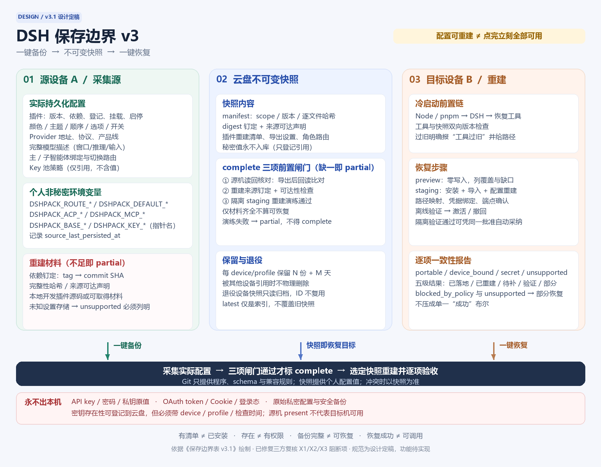

# DSH 保存边界表 v3：一键备份、跨设备一键恢复

- 规范版本：3.1.0；修订日期：2026-11-01（v3.1 修复三方复核的 X1/X2/X3 阻断项与 Y1-Y9 收紧项）。
- 状态：**按用户最新目标调整的规范方案，尚非功能完成或版本发布声明。**
- 替代：[保存边界表v2](storage-boundaries-v2.md)中“云盘长期维护期望配置/持续多设备同步”的目标与相应图示；保留其秘密本机、最小登记、安全校验和真实恢复验证原则。
- 复核：Kimi K3 与 GLM 5.3 Flash 独立复查，主控终裁见 `.ptc/reports/storage-v3-final-adjudication.md`。
- 范围：源设备选定profile及其关联插件和个人设置的可迁移配置环境；不是整机克隆，也不默认迁移密钥、登录态、会话或运行中任务。

## 保存边界总览图

[可编辑 SVG 原图](assets/storage-boundaries-v3.svg)。左栏是采集源，中栏是恢复目标，右栏是重建过程；底部红条为永不出本机的秘密与登录态。图为设计说明，不表示全部功能已实现。

## 1. 唯一目标与权威来源

> 设备A点击一次备份：自动收集当时实际安装和持久化的插件、Provider、模型、智能体/切换路由及颜色选项，形成完整、脱敏、版本化资源包。设备B选择该包后点击一次恢复：自动安装重建并逐项验收；密钥、登录和必要安全确认可形成明确的人工作业项。

**源设备的实际持久化配置是采集来源；选定的不可变备份快照是本次恢复目标。** 不要求用户事先逐项编辑云盘清单，不因新增个人插件、Provider或模型而要求先提交Git/发配置包版本。只有新插件格式缺少导入导出适配、适配器能力不足等程序兼容变更才需要升级工具。

**限制（必须前置告知）**：本规范承诺的是“配置可重建 + 明确待办”，不是“点完立刻全部可用”。密钥、OAuth/CLI 登录、宿主与 CLI 版本安装必须由人或受控流程完成，无法由快照自动完成。

这里的“一键”指一个统一入口协调全部步骤：一次点击触发 + 一张清单批量确认。不承诺首次登录、密钥补充、权限批准、网络失败都能无人干预。新设备缺密钥时可以完成配置还原，但只能报告“配置已还原，凭据待补”，不能报告“全部可调用”。

## 2. 与v2的冲突裁决

| 旧方案 | 是否冲突 | v3处理 |
| --- | --- | --- |
| 云盘长期维护个人desired，用户选择先进入该文件 | 是 | 改为备份自动采集实际设置，不增加第二份人工配置 |
| Git默认→云盘个人配置→目标机覆盖决定恢复值 | 是 | 恢复以所选快照为准；Git只提供兼容工具和缺项迁移默认，不能用最新默认盖掉快照 |
| 实际插件安装清单仅作观测参考 | 部分 | 源机实际安装、登记、挂载、顺序成为重建输入；激活/失败报告仍只是源机证据，目标机必须重验 |
| 模型目录仅作观察快照 | 部分 | 已配置模型必须有可重建完整声明或明确运行时要求；纯发现目录不自动成为启用项 |
| 云盘设备覆盖持续合并 | 部分 | 快照保存类型化路径/设备参数，恢复时生成目标机映射；一般颜色/开关不当成设备差异跳过 |
| 持续监听、多设备并发修改shared期望态 | 取消本期范围 | 按需生成独立snapshot_id；保留多设备版本，用户选择恢复点，不开发同步守护进程或复杂多主合并 |
| key值本机、存在性云盘登记 | 否 | 完整保留；源/目标存在性分开，读不到为unknown |
| schema、隐私、兼容、权限、哈希与恢复演练 | 否 | 保留并落实到备份/恢复成功闸门 |

## 3. 三处保存位置

| 位置 | v3职责 | 不承担 |
| --- | --- | --- |
| Git配置包 | 备份恢复程序、设置导出适配器、schema/迁移规则、通用兼容基线、默认模板 | 不逐次登记个人增改，不作为某次恢复的最新个人配置 |
| 私人云盘备份包 | 从源机自动导出的不可变配置环境快照、插件重建材料、密钥存在性登记及校验/缺口报告 | 不保存秘密值/登录态，不作为随手双向改写的在线运行配置 |
| 设备本机 | 源机采集、目标机安装与生效配置；秘密值、本地信任、临时状态、恢复前安全快照 | 不把运行计数、在途任务、源机授权结果重放到目标机 |

## 4. 完整保存矩阵

✅=在该位置**权威**保存该行定义的数据；△=模板、版本引用、派生副本或脱敏快照，**不是另一份独立权威配置**；❌=不收录。同一行原则上只应有一个 ✅ 权威位置；若出现第二个 ✅（如 M02），该行必须写明冲突裁决。表是设计要求；“部分/待实现/基线/本机约束”表示此前审查范围的粗粒度实施差距，不代表任意目标设备已验收。旧ID保留可追溯；P10 处理本地插件材料，E01 处理个人非秘密环境变量。

### 插件与运行时

| ID | 保存项 | Git配置包 | 云盘备份包 | 设备本机 | 恢复行为 | 实施状态 |
| --- | --- | :---: | :---: | :---: | --- | --- |
| P01 | 通用推荐插件、兼容版本与安装来源；发布者 | ✅ | △ 发布引用 | △ 安装副本 | 按可信固定版本安装，登记 bundle 顺序 | 基线 |
| P02 | 源机实际保存的插件选择、版本约束、启停 | △ 默认模板 | ✅ 配置快照 | ✅ 采集源 | 备份自动采集，不要求预先维护云盘期望文件 | 待实现 |
| P03 | 源机实际插件版本、依赖、登记/挂载/加载顺序/激活事实 | ❌ | ✅ 重建清单＋源机报告 | ✅ 采集源 | 按快照重建安装和挂载；源机已失效项显式报告，不冒充健康配置 | 待实现 |
| P04 | 插件安装、迁移、回滚和验收程序；发布者 | ✅ | △ 版本引用 | △ 执行副本 | 使用同一工具接口；按钮/skill 不另写同步逻辑 | 基线 |
| P05 | 插件颜色、主题、顺序、选项、开关及其他可迁移设置 | △ 默认模板 | ✅ 设置快照 | ✅ 实际设置源 | 按插件适配器导出文件/存储/数据库/浏览器设置，并读取目标机结果核对 | 部分 |
| P06 | DSH/pi-ai/CLI 兼容基线；发布者 | ✅ | △ 引用 | △ | 先检查最低/最高兼容要求 | 部分 |
| P07 | 源机持久化版本选择、安装参数与兼容约束 | △ 基线 | ✅ 配置快照 | ✅ 采集源 | 备份时自动收集；不要求用户独立登记版本目标 | 待实现 |
| P08 | 实际DSH/pi-ai/CLI版本、平台与来源 | ❌ | ✅ 重建信息＋报告 | ✅ 采集源 | 精确版本优先；仅经确认采用兼容替代，不擅自装最新版本 | 部分 |
| P09 | 标准程序、CLI、node_modules和下载缓存 | ❌ | ❌ 默认不整目录复制 | ✅ 安装结果 | 按固定来源和依赖锁重建。**钉定必须到 commit SHA / 完整性哈希级，不能只用 tag 或 `^` 范围**；离线安装另声明材料与许可范围；拉取失败在恢复报告标 `needs_source` 并降级 partial | 本机约束 |
| P10 | 本地开发/手工安装插件的可重建来源或必要源码材料 | △ 可取得来源引用 | ✅ 脱敏材料/固定来源，条件收录 | ✅ 原始来源 | link路径不够；含未提交修改需收录可核验材料；缺材料即partial；不整包携带凭据/缓存 | 待实现 |

### Provider与模型

| ID | 保存项 | Git配置包 | 云盘备份包 | 设备本机 | 恢复行为 | 实施状态 |
| --- | --- | :---: | :---: | :---: | --- | --- |
| M01 | Provider 协议、鉴权方式、适配器与兼容处理；发布者 | ✅ | ❌ | △ | 仅从可信程序版本取得，云盘不注入可执行适配代码 | 基线 |
| M02 | 恢复所需的完整模型协议、端点产品线、窗口、输入、推理等元数据 | ✅ 通用兼容基线 | ✅ 实际模型描述或明确运行时要求 | ✅ 采集源 | 已配置模型必须可重建；缺描述且旧适配器不认识时不能标完整。**冲突裁决：快照有完整描述时以快照为准，Git 仅补快照缺失字段；两者差异必须写入恢复报告，不得静默采用 Git 值** | 部分 |
| M03 | 源机新增/修改Provider的地址、协议、产品线、启停和凭据引用 | △ 默认示例 | ✅ 配置快照 | ✅ 实际配置源 | 自动导出全部实际Provider，不限Git已知列表；新端点绑定本机key须批准 | 部分 |
| M04 | 源机模型启用/隐藏/收藏、参数与自定义覆盖 | △ 默认模板 | ✅ 配置快照 | ✅ 实际配置源 | 还原最后保存的选择；不用Git最新默认覆盖快照 | 部分 |
| M05 | 最后一次持久化模型刷新结果、目录发现与来源时间 | ❌ | ✅ 发现报告 | ✅ 采集源 | 备份采集已有刷新结果，不默认联网刷新；报告不等于已启用模型 | 部分 |
| M06 | 源机实际注册模型与完整性检查报告 | ❌ | ✅ 源机观测 | ✅ 实时检测 | 报告不直接当目标机事实；恢复描述后重新注册并比较 | 待实现 |
| M07 | 模型请求验证状态；经授权探测器 | ❌ | ✅ 最小脱敏 源机报告 | ✅ 当前结果 | 区分未测/成功/无权/额度不足等；网络与付费探测需批准 | 待实现 |
| M08 | DSH/ACP/CLI命名空间和逻辑模型/路由映射 | △ schema/默认映射 | ✅ 快照映射 | ✅ 采集源 | 自动提取引用并校验闭包；区分套餐/公共API和relay，不按相似名字猜测 | 待实现 |

### 密钥登记与Key池

| ID | 保存项 | Git配置包 | 云盘备份包 | 设备本机 | 恢复行为 | 实施状态 |
| --- | --- | :---: | :---: | :---: | --- | --- |
| K01 | 凭据读取规则、默认变量名、必需性；发布者 | ✅ | △ 模板引用 | △ | 将逻辑引用绑定本机凭据，不导入源机值 | 基线 |
| K02 | 源机凭据引用、变量名、Provider绑定、用途 | △ 默认模板 | ✅ 引用快照 | ✅ 采集源 | 不带密钥值；目标机绑定现有凭据或提示补充 | 部分 |
| K03 | 源机Key存在性、来源类型、device/profile、检查时间与有效期 | ❌ | ✅ 受限登记 | ✅ 本机探测 | 目标机独立复查，不继承源机present。TTL 由策略显式设置；超过 `expires_at` 一律显示 stale/unknown，不据旧 present 判可用 | 待实现 |
| K04 | 凭据调用验证分类与时间；经授权探测器 | ❌ | ✅ 最小脱敏 源机报告 | ✅ 当前结果 | 和存在性分开；原始错误、额度明细默认只留本机 | 待实现 |
| K05 | API key、密码、私钥原值；用户/系统凭据存储 | ❌ | ❌ | ✅ 私密存储 | 用户本机补充或连接独立凭据管理器 | 本机约束 |
| K06 | Key 子串、前后缀、完整哈希、Authorization 头；本机秘密处理 | ❌ | ❌ | △ 必要处理 | 不用于云盘去重或追踪凭据身份 | 本机约束 |
| K07 | OAuth/CLI 是否已认证、是否需重登及检查时间；探测器 | ❌ | ✅ 最小脱敏 源机报告 | ✅ 实时检测 | 新设备独立检查，必要时交给人登录 | 待实现 |
| K08 | OAuth token、refresh token、Cookie、登录缓存；认证系统 | ❌ | ❌ | ✅ 私密存储 | 不复制源设备登录态 | 本机约束 |
| K09 | Key池成员逻辑引用、顺序、权重与启停 | △ 策略模板 | ✅ 配置快照 | ✅ 采集源 | 自动收集最新保存策略，重建池结构而非复制秘密值 | 部分 |
| K10 | Key 池实时失败、额度、限流、冷却倒计时；本机运行时 | ❌ | ❌ | ✅ | 不跨设备恢复；目标机重新累积 | 本机约束 |

### 主/子智能体与切换路由

| ID | 保存项 | Git配置包 | 云盘备份包 | 设备本机 | 恢复行为 | 实施状态 |
| --- | --- | :---: | :---: | :---: | --- | --- |
| R01 | 路由算法、失败分类、候选生成；发布者 | ✅ | ❌ | △ | 云盘只输入受支持参数，不替换算法代码 | 基线 |
| R02 | 源机主智能体默认Provider/model/effort | △ 出厂默认 | ✅ 配置快照 | ✅ 采集源 | 恢复相同保存值；不改变当前正在运行会话，不被最新默认覆盖 | 部分 |
| R03 | 源机子智能体角色Provider/model/effort绑定 | △ 出厂默认 | ✅ 角色快照 | ✅ 采集源 | 从实际角色权威配置导出，恢复后验证工具和模型引用 | 部分 |
| R04 | 源机子代理启动配置、工具选择、权限声明及本机安全上限 | ✅ 程序/规则 | ✅ 可迁移声明，不含秘密 | ✅ 实际配置＋本地批准 | 参数按schema还原；可执行来源/权限变化提示确认，云盘不自动提升权限 | 部分 |
| R05 | 源机子代理白名单、角色开关与优先级 | △ 默认模板 | ✅ 配置快照 | ✅ 采集源 | 还原已保存选择，但不突破本机安全上限；发现新模型不扩大白名单 | 部分 |
| R06 | 源机Provider failover顺序、开关、阈值、冷却时长 | △ 默认策略 | ✅ 配置快照 | ✅ 采集源 | 自动收集实际路由配置并还原；Host与ACP切换分别验证 | 部分 |
| R07 | CLI 存在、ACP 握手、子代理派发结果；探测器 | ❌ | ✅ 源机报告 | ✅ 重新检测 | PATH 存在仅第一层；真实派发需隔离、最小权限和预算批准 | 部分 |
| R08 | 当前会话实际模型、失败计数、冷却倒计时、在途任务；本机运行时 | ❌ | ❌ | ✅ | 不从备份重放；旧会话与新会话分别识别 | 本机约束 |

### Agent与个人设置

| ID | 保存项 | Git配置包 | 云盘备份包 | 设备本机 | 恢复行为 | 实施状态 |
| --- | --- | :---: | :---: | :---: | --- | --- |
| A01 | 内置 Agent、通用提示词、预设和权限模板；发布者 | ✅ | ❌ | △ | 固定版本安装；模板不是本机权限批准 | 基线 |
| A02 | 个人Agent、提示词、预设、角色与工具配置 | ❌ | ✅ 脱敏配置快照 | ✅ 采集源 | 从实际存储导出；含不允许外传内容需显式遗漏，不静默删后标完整 | 部分 |
| A03 | 默认预设、普通工具开关、插件/界面偏好 | △ 默认模板 | ✅ 配置快照 | ✅ 采集源 | 非设备绑定值精确还原；目标插件实际读取后比对 | 部分 |

### 设备身份、路径与环境变量

| ID | 保存项 | Git配置包 | 云盘备份包 | 设备本机 | 恢复行为 | 实施状态 |
| --- | --- | :---: | :---: | :---: | --- | --- |
| D01 | 源机路径、代理、CLI位置、DSH_HOME及设备绑定参数 | △ 字段定义 | ✅ 类型化路径与来源信息 | ✅ 采集源/目标映射 | 自动提取；目标机按角色映射，来源机器绝对路径不是目标机器地址 | 部分 |
| D02 | 路径/代理内的密码令牌；本机凭据存储 | ❌ | ❌ 只允许引用 | ✅ | 去掉嵌入式秘密值；新端点绑定重新批准 | 本机约束 |
| D03 | 设备身份、profile 身份、退役标记；设备登记工具 | △ schema | ✅ 受限登记 | ✅ 本机身份 | 使用稳定 ID，不以可重名设备名称作为唯一键 | 待实现 |
| E01 | **个人非秘密环境变量**：`DSHPACK_ROUTE_*`（路由 id）、`DSHPACK_DEFAULT_*`（默认 provider/model）、`DSHPACK_ACP_*`/`DSHPACK_MCP_*`（开关）、`DSHPACK_BASE_*`（端点）、`DSHPACK_KEY_*`（凭据指针名）等 | △ 变量名与语义定义 | ✅ **变量名 + 语义值 + 来源层**（值/指针原文，非密钥值） | ✅ 采集源 / 目标机绑定 | 备份自动采集已持久化的变量值；目标机逐项绑定或映射，`BASE_*` 指向内网/新 host 与 `KEY_*` 改名须确认。目标机缺变量时报告 `needs_manual`，**不得静默回退到默认值**；密钥值仍由 K05 排除 | 待实现 |

E01 的环境变量采集是快照保存语义，不等于 llm-pi-ai 运行期覆盖：旧 BASE/KEY 输入由 setup/install/update 的迁移脚本转换为字面量配置；个人 provider 差异仍由共享盘或本机 device 目录承载。

### 备份、信任与历史数据

| ID | 保存项 | Git配置包 | 云盘备份包 | 设备本机 | 恢复行为 | 实施状态 |
| --- | --- | :---: | :---: | :---: | --- | --- |
| B01 | 配置包/资源包 schema、兼容要求和迁移程序；发布者 | ✅ | △ 版本引用 | △ | 不支持的必填字段或版本直接拒绝，显式迁移 | 部分 |
| B02 | 源profile层、插件设置、预设与规范化恢复配置 | ❌ | ✅ 不可变快照 | ✅ 一致性采集源 | 分开保留脱敏来源层和恢复语义，防止丢失覆盖关系；raw配置作为惰性证据不直接执行 | 部分 |
| B03 | 含秘密的原始配置和私密安全快照；本机备份器 | ❌ | ❌ | ✅ 本机私密备份 | 和普通云盘资源包严格分开 | 本机约束 |
| B04 | 快照ID、完整清单、哈希、依赖锁、scope、缺口与完成标记 | △ schema | ✅ 版本清单 | ✅ 校验/落地记录 | 逐项完整性与引用闭包校验；partial默认不得镜像激活 | 部分 |
| B05 | 备份采集报告、恢复计划、差异、验收与补偿记录 | ❌ | ✅ 最小脱敏报告 | ✅ 本机执行证据 | 按每个scope项目对账，严格区分配置恢复与真实可调用 | 待实现 |
| B06 | 本地信任锚、批准记录、凭据出站 host 绑定；用户/本机策略 | △ 协议和规则 | ❌ 权威信任锚不随包导入 | ✅ | 首次来源及敏感变更由本机确认；SHA 不当来源认证 | 待实现 |
| B07 | 会话、附件、日志、插件数据库；专门归档工具 | ❌ | ❌ 不纳入本资源包 | ✅ 独立归档 | 按另一个明确授权的备份范围处理 | 本机约束 |
| B08 | 缓存、临时文件、进程锁、在途任务状态；本机运行时 | ❌ | ❌ | ✅ 临时状态 | 重建；不把依赖锁清单误作进程锁排除 | 本机约束 |

## 5. 备份包与采集一致性

建议布局（尚未实现）：

    dsh-device/backups/<source-device-id>/<profile-id>/<snapshot-id>/
      manifest.json                 # scope、版本、哈希、状态、提交标记
      runtime/                      # DSH/pi-ai/CLI/平台及兼容信息
      plugins/                      # 实际插件重建清单、登记顺序、导出设置
      config/                       # Provider、完整模型、角色、路由和普通选项
      source-layers/                # 可安全导出的来源层，惰性证据
      local-plugin-sources/         # 必要且获准的脱敏重建材料，不是整个node_modules
      credentials/inventory.json    # 引用与存在性登记，无秘密值
      reports/                      # 采集缺口及源机观测，不冒充目标机事实

- 一次备份扫描实际profile与插件；不能只导出Git预置或工具硬编码的几个Provider。
- 采集“已安装”“管理器已登记”“配置已挂载”“进程已激活”四项，避免目录存在就算安装成功。
- 必须有稳定snapshot_id、source_device_id、profile_id、生成时间、采集schema/工具版本、兼容要求、来源版本和文件哈希。目标报告放另一个恢复记录，不修改源快照。
- scope由系统自动盘点并让用户确认，用户可选profile/类别；不能靠缩小scope掩盖新增插件未知设置。列出captured、redacted、unsupported、missing、not_applicable、excluded_by_scope和待人工项；对功能必需的redacted项标明替代/绑定方式。
- 采集前请求保存/导出并刷新设置。**每个采集项记录 `source_last_persisted_at`**；备份报告必须固定声明“备份只覆盖已持久化状态”，适配器能检测脏状态时标 `pending_flush` 并降级 partial。不声称能自动读取未保存的内存状态。
- **按存储类型规定机制，不能只写“一致性导出”**：SQLite 必须用 backup API 或先 checkpoint（禁止直接复制 WAL 主文件）；浏览器存储只能通过获准的导出接口读取指定应用设置，不复制整个浏览器 profile/Cookie；文件型配置先请求刷新再读。采集中版本或文件变动则重试（有上限）或明确失败/partial，不混合多个时点。
- **备份期源机读回核对（complete 前置）**：导出后必须从源机实际存储/接口读回生效值，与快照内容逐项比对；不一致即 partial。只比对目标机与快照（恢复后）无法发现“采集器漏导”的字段——那会在备份→恢复→matched 全链自隐。
- 快照先本机暂存，完成校验再上传独立版本并写完成标记。目标忽略半上传包；latest只是便利索引，不覆盖旧备份、不代表任意设备都应自动恢复。多源设备备份互不覆盖。
- 新增/删除/修改只体现在各自完整快照中；不把两个快照自动合并，也无需将文件同步盘设计成多主数据库。

### 5.1 快照保留、过期与设备退役

- 每个 `device-id/profile-id` 至少保留最近 N 份快照与最近 M 天（N、M 由策略显式配置），避免云盘无限增长。
- `latest`/前一份指针只作便利索引；删除任何快照前必须确认没有其他设备把它作为恢复目标或回滚点，仍被引用时只标记可回收、不物理删除。
- 设备退役后其快照转为只读归档或按策略清理；**退役设备的 device-id 不得复用**。
- 备份报告中记录本次快照的保留期限与被清理项；清理脚本默认 dry-run。

## 6. 插件颜色和选项：完整采集的硬要求

不能只复制几种固定文件名或一律排除storages/数据库。每个插件的采集计划必须标明设置实际位于：profile层、插件配置文件、DSH存储、插件数据库、浏览器localStorage/IndexedDB或受支持导出接口。

1. 优先用插件官方导出/导入接口；其次使用已验证版本的专用适配器；已知安全且纯配置的文件可直接复制。
2. 混合配置与秘密的文件/数据库只做字段级安全导出，不能上传整个库；无法可靠区分时明确unsupported，不能静默漏项后标完整。
3. 浏览器设置须通过获准的导出机制读取指定应用设置，不扫描或复制整个Chrome profile、Cookie或登录缓存。浏览器不可访问、版本不支持或需人工交接时记录缺口。
4. 颜色值、选项、开关、排序保留其类型和准确值；目标插件版本相同优先，版本改变须经过显式schema迁移并报告语义变化。
5. 恢复后必须让插件重新加载并读取设置核对，必要时重启。文件内容一致不等于插件实际采用一致。
6. 未知插件或手工挂载类必须出现在清单；来源不可取得、local link指向不在包中的目录、存在未备份修改时，包不得标为可完整重建。
7. 不向用户承诺“任意插件零适配完整迁移”；承诺自动盘点、尽可能采集、不可迁移项显式失败并推动增加适配器。
8. **每个设置项必须带分类标签**（适配器 schema 强制，不得由工具猜测）：`portable`（应精确复制）、`device_bound`（设备绑定，须由插件 manifest 显式声明并映射）、`secret`（只留本机，仅登记引用）、`unsupported`（无法采集，必须计入 partial）。没有标签的项按 `unsupported` 处理，不得默认当作 portable。

## 7. 模型、Provider与凭据

- Provider导出包括实际地址、协议、产品线、开关、凭据引用、模型和覆盖参数；地址内含秘密时改为引用并报告，不原样上传。
- 备份已保存的最新模型刷新结果；默认不主动联网、不付费、不改变模型启用状态。已配置模型与只发现未启用模型必须分开。
- 恢复清单不能只有模型ID：要么有目标适配器可解析的完整模型描述（含协议和能力），要么固定能识别它的运行时版本。多协议Provider不能粗暴设置一条全局协议掩盖所有模型。
- DSH、ACP、CLI、公共API、Coding套餐和relay命名空间分别记录映射，不以同名推断相同授权。完整模型信息来源和未确认项必须可追溯。
- key原值、密码、私钥、OAuth token/Cookie/refresh token不进普通云盘包。源机登记credential_ref、provider_ref、device/profile、source_kind、presence三态、checked_at/expires_at；可选probe分类另存，不保存原始错误、headers或key子串/hash。
- 目标机自己检查是否有对应凭据；源机present不能变成目标机present。缺密钥、需重登或需批准应作为明确恢复结果，不能靠反复重试掩盖。
- Git通用规则和schema可用于补充兼容逻辑，但不得将源机自定义Provider、模型、颜色和路由恢复成出厂默认。

## 8. 统一一键入口：备份和恢复

本节定义目标流程，不宣称已有同名CLI已实现。按钮、skill和CLI调用同一后端接口，不各自实现导出或恢复。

### 8.1 备份

选profile与scope → 保存/冻结一致性点 → 自动扫描与设置导出 → 凭据分离与秘密字段检查 → **源机读回核对** → **重建来源 digest 钉定与可达性检查** → **隔离 staging 重建演练** → 生成manifest与完整性状态 → 云盘发布不可变快照。

**complete 的三项前置闸门**（缺一即不得标 complete）：

1. **源机读回核对**：导出后从源机实际存储/接口读回生效值并与快照比对，不一致即 partial。
2. **重建来源钉定**：每个依赖记录 commit SHA / 完整性哈希级钉定与来源可达声明；只记 tag 或版本范围不算钉定（tag 可移动、上游可撤包、私有仓库目标机可能无权限）。不可达且未携带离线材料时降级 partial，并在报告写明“目标机重建需要 X 可用”。
3. **隔离 staging 重建演练**：在隔离目录按快照实际重建一次并通过离线验证。**仅有材料清单齐全不算可恢复**；演练失败即 partial。发布程序版本时的一次性演练不能替代每个快照的演练。

状态定义：

- complete：声明scope内必需可迁移配置与重建材料齐全，**且三项闸门全部通过**，合法秘密引用除外；不等于整机克隆、不等于目标机已有凭据、不等于已做所有真实调用。
- partial：至少存在未采集设置、未知存储、缺失源码/依赖、不可达来源、读回不一致、演练失败或不支持项；仍可保留供抢救，但不能显示“完整备份成功”。
- failed：无法形成一致可校验的快照；不切换 latest 指针。
- 只有备份/恢复实现的可靠输出才能赋予状态；压缩成功、上传完成、退出 0 本身不替代完整性判定。

### 8.2 冷启动前置链

全新设备（无 DSH、无 profile、无恢复工具）必须先满足前置链，v3 契约要求把它成文化：

1. 安装 Node 与 pnpm。
2. 安装 DSH 本体（受支持版本区间）。
3. 取得配置包/恢复工具（Git 固定 tag 或离线包）。
4. 校验恢复工具版本与目标快照的**双向兼容**：快照记录采集工具版本与最低恢复工具版本；工具过旧不得静默降级解析，工具过新遇到旧快照按 B01 走显式迁移或拒绝并给出可用的旧工具获取方式。
5. 之后才进入 8.3 的 preview 与恢复。

任一步失败必须给出明确阻塞原因与下一步，不得表现为“恢复失败”而掩盖“工具没装好”。

### 8.3 恢复模式

| 模式 | 默认与行为 | 目标设备多出的配置 |
| --- | --- | --- |
| 隔离恢复 | 默认在新 profile/隔离目录重建快照；**验证通过后可凭同一次批准自动采纳为目标 profile**，无需第二段人工决策 | 保留原环境，不删除 |
| 镜像恢复 | 用户明确选择目标profile并批准替换；在scope内尽量等同所选快照 | 列出将停用/移除的额外项，确认后处理；scope外不动 |
| 合并恢复 | 显式可选；逐项冲突预览和选择 | 可保留，但结果不得宣称严格镜像一致 |

镜像恢复仅覆盖可迁移scope，绝不删除目标机已有秘密或无关资源。普通颜色/选项不能被当成“设备差异”静默保留；真正设备路径和安全批准可以不同，但必须报告映射和例外。某插件仅安装不激活、或停用仍留安装目录，要分别记录而非混为同一状态。

### 8.4 恢复步骤与闸门

1. 选择snapshot_id、目标profile和模式；preview零写入，明确覆盖、缺口、路径映射、下载/安装/网络/付费请求及权限变化。
2. 验包来源、完成标记、全部文件哈希、schema和兼容要求；未知字段按schema规则处理；partial默认阻断镜像激活，显式抢救只恢复选定安全项并标部分结果。
3. 用户批准后建立目标机安全快照；统一从批准的DSH_HOME解析所有资源根，避免一部分写默认用户目录、一部分写自定义根。
4. 在staging安装所需DSH/pi-ai/插件/CLI与本地插件材料；按包中的准确版本和锁信息优先重建。仅经确认采用平台兼容替代，不能无提示使用最新版本。
5. 从快照导入普通配置、颜色选项、Provider模型、角色与路由；编译或重建配置层并保持覆盖顺序，不把未评估的raw JS/shell直接执行。原有模板表达式须由可信迁移适配器识别，未知可执行配置列不支持/需批准。
6. 映射目标机路径和本机秘密引用。Provider host、执行入口、安装钩子、权限提升与凭据出站绑定需独立批准，不能以“严格复制”绕过安全上限。
7. 离线验证引用闭包、模型能力、插件登记与加载；按批准范围进行运行验证，再激活或撤回。必要时重启DSH并新开会话；涉及宿主升级不能承诺无停机热替换。
8. 导出逐项一致性结果及后续人工项。登录由人完成；PATH存在、启动通过和真实派发成功分层记录，未测不冒充通过。

安装、登录和网络/付费动作有外部副作用，只能按能力补偿；不能承诺全事务回滚。原生效配置在预检查失败时不变，激活后失败须记录撤回及人工处置。不得默认扫描或导出任意秘密值；未知敏感格式必须失败/partial而非“猜测脱敏成功”。

## 9. 成功判定：必须给出两份报告

**备份报告**说明备份了什么、没备份什么、是否具备重建材料。**恢复报告**逐项比较所选快照与目标机结果，包含matched、mapped、migrated、missing、unsupported、blocked_by_policy、needs_credentials、needs_login、untested等有限分类。

这些分类不应压成一个“成功”布尔：

| 恢复级别 | 判定 |
| --- | --- |
| 文件已落地 | 仅复制完成，不能称配置恢复完成 |
| 配置已重建 | 可迁移配置和安装/加载关系一致；映射与例外已列明 |
| 待补条件 | 缺密钥、需登录、需重启或权限批准；明确待办，不称全部可用 |
| 受控验证通过 | 用户批准范围内目标机模型/插件/子代理验证通过；报告测试时间和未测范围 |
| 部分恢复/失败 | 缺配置或材料、校验失败、unsupported或策略阻断等未解决；不显示严格复制成功 |

严格一致性指：插件版本/启停/登记挂载、普通颜色选项、Provider模型、Agent与切换规则在可迁移 scope 内一致。允许的差异仅为已报告的平台路径/秘密绑定/必要兼容迁移及本地安全限制；若这些导致功能或语义变化，结果须降级并提示，不能偷偷标一致。

### 9.1 分类 → 五级结果 的确定性映射

逐项分类不得直接当结论；必须按下表映射，避免同一项在不同实现里得到不同级别：

| 项的分类 / 状态 | 对应恢复级别 | 说明 |
| --- | --- | --- |
| 全部 portable 且读回一致 | 配置已重建（可升受控验证通过） | 仍需目标机实际加载核对 |
| device_bound 已按 manifest 映射且功能等价 | 配置已重建 | 报告写映射前后值 |
| device_bound 映射后语义变化 | **部分恢复** | 必须降级，不能标一致 |
| 仅缺密钥 / 仅需登录 | 待补条件 | 配置本身已一致，只差凭据 |
| 仅需权限批准（配置已一致） | 待补条件 | 不得升为“通过” |
| blocked_by_policy | **部分恢复** | 策略阻断属未解决项，不属“待补条件” |
| unsupported | **部分恢复** | 必须计入缺失清单 |
| untested（未获批准验证） | 待补条件或受控验证通过（限定范围） | 报告必须写明未测范围，不得默认通过 |

## 10. 必测场景

| ID | 备份→恢复反例 | 必须结果 |
| --- | --- | --- |
| V301 | 源机新增非Git默认插件，修改颜色和开关后备份 | 无需预编辑云盘，目标机版本/挂载/显示配置一致 |
| V302 | 源机新增Provider并修改模型/推理参数 | 自动采集完整配置，目标机可注册，旧Git默认不覆盖 |
| V303 | 已保存刷新模型，目标机pi-ai目录较旧 | 明确重建描述/最低运行时；不能仅ID落地就称成功 |
| V304 | 修改主agent、子agent绑定、failover与Key池策略 | 快照包含全部修改；Key值不出本机 |
| V305 | 插件设置在数据库、DSH存储或浏览器存储 | 受支持适配器安全导出并读回核对；不支持则partial |
| V306 | 插件为手工挂载、local link或源码有未提交修改 | 记录来源和挂载；材料不够不可标complete |
| V307 | 备份过程中设置再次修改、数据库忙 | 重试一致性采集或失败/partial，不混合多个时点 |
| V308 | 目标机缺key或登录，源机登记present | 源机状态不迁移为目标可用；报告待补条件 |
| V309 | 包含key、Cookie、原始错误或权限提升/恶意host | 秘密导出阻断；敏感绑定和执行变化需明确批准 |
| V310 | 目标机多出插件、Provider或颜色配置 | 隔离保留原环境；镜像经确认处理；合并不得称严格一致 |
| V311 | partial/半上传包/哈希变更/旧schema与显式降级 | 默认安全阻断或受控迁移；不以同包SHA证明来源可信 |
| V312 | 源机绝对路径与目标机平台/DSH_HOME不同 | 明确映射、统一目标根；不能写错profile或抹掉其他环境 |
| V313 | 恢复脚本成功但插件未激活或没读取颜色 | 验收失败或部分恢复，报告实际加载差异 |
| V314 | 安装后验证失败，已有认证或付费副作用 | 可恢复配置，记录不可撤销动作与补偿，不谎报全回滚 |
| V315 | 新旧快照中有新增、修改、删除和停用 | 选择快照决定目标；不自动多主合并或复活其他快照条目 |
| V316 | 发布tag、zip生成或preview通过但未真正恢复 | 不作为恢复能力证据；需隔离staging演练和目标机逐项报告 |
| V317 | 源机修改 `DSHPACK_ROUTE_KIMI`/`DSHPACK_DEFAULT_MODEL`/`DSHPACK_ACP_*` 后备份 | 变量层被采集并在目标机绑定；目标机缺变量时报 `needs_manual`，不静默回退默认值 |
| V318 | 适配器故意漏导某插件一个字段 | 备份期源机读回核对发现不一致 → **partial**，不得 complete |
| V319 | 材料清单齐全但依赖锁指向已撤下版本 | 隔离 staging 重建演练失败 → **partial**，不得 complete |
| V320 | Git 基线模型元数据与快照描述冲突 | 以快照为准落地并报 `migrated`；差异写入报告，不静默采用 Git 值 |
| V321 | 快照数超过保留策略、设备退役 | 按 N 份/M 天清理且被引用时不物理删除；退役 device-id 不复用 |
| V322 | 插件 SQLite 有未 checkpoint 的 WAL 写入 | 用 backup API/checkpoint 采集；直复制导致丢失时必须是 failed/partial |
| V323 | 同一设置项在不同实现里被判为 blocked_by_policy 与“允许差异” | 按 9.1 映射表得到同一级别（部分恢复），不得一项两判 |
| V324 | 快照中 Key 登记已过 `expires_at` | 显示 stale/unknown，不据旧 present 判可用，不升级为 matched |
| V325 | 全新设备冷启动，恢复工具版本低于快照最低要求 | 明确报“工具过旧”并给出获取路径；不得表现为普通恢复失败 |
| V326 | 隔离恢复验证通过 | 凭同一次批准自动采纳为目标 profile，不需要第二段人工决策 |

## 11. 现状、迁移与实施顺序

这是规范调整，不是软件实现。此前只有部分配置文件备份、安装及模型目录摘要能力；未完成所有插件存储适配、完整Provider自动盘点、全量可移植模型描述、跨平台重建和逐项一致性验收。不得引用本规范声称当前“一键完整恢复”已有效。

- v2及其三栏图保留为历史材料，明确已被v3替代；不得再按长期维护云盘desired实施本目标。
- 旧云盘device.env/route配置/模型快照仅为导入材料，缺少插件设置和重建信息时不能直接升格为complete快照。旧备份缺的内容需回源机重新采集。
- 旧配置包安装流程仍用于干净安装；选快照恢复是不同模式，不能在恢复途中默认走“全部最新模板安装”把个性化配置覆盖掉。
- P0：定义快照manifest/scope/完整性状态、自动盘点、凭据分离、来源/目标绑定、一致性采集，以及 8.1 的三项 complete 前置闸门（读回核对、digest 钉定、staging 演练）。
  - **已落地的 P0 骨架**（2026-11-01，尚未发布版本）：`schemas/snapshot-manifest.v1.json` 定义 v1 manifest；`scripts/snapshot.mjs` 提供 `inventory`/`backup`/`verify`/`restore --dry-run`；`scripts/test-snapshot.mjs` 覆盖三项闸门、密钥排除、篡改检测与恢复阻断。
  - **P1 已补齐的部分**（2026-11-01）：Provider 改为结构化导出（api、baseURL/apiKeyEnv 的模板与默认值、模型 contextWindow/maxTokens/input/reasoningEfforts）；插件设置改为适配器驱动（`assets/plugin-settings-adapters.json`，含 `optional` 源语义与 `portable/device_bound/secret/unsupported` 分类）；新增第四道闸门 **settings_coverage**；凭据按 Provider 的 `apiKeyEnv` 默认值登记需求，presence 保持 `unknown`（硬策略只读 `DSHPACK_` 前缀，不读密钥）。
  - **P2 已补齐的部分**（2026-11-01）：插件设置支持三种源——`file`、`sqlite`（`VACUUM INTO` 一致性导出，天然包含 WAL 内容，需 `node:sqlite`）、`export-json`（消费显式导出件，**不抓取浏览器 profile**）；恢复支持 `isolate`/`mirror`/`merge` 三模式，mirror 的额外文件先隔离到 `.snapshot-quarantine/` 再移除，绝不原地删除；`--rehearse-install` 会在 staging 目录执行真实的 `pnpm install --frozen-lockfile --ignore-scripts --offline`。
  - **真实演练发现并修复的缺陷**：初版 staging 只复制 profile 六个文件，未带 `patches/`，导致 `pnpm-workspace.yaml` 的 `patchedDependencies` 找不到补丁——已修复。
  - **P3 已补齐的部分**（2026-11-01）：新增 `cordis-config` 源（从 profile 层抽取插件行配置做逐插件覆盖，恢复标记为 `reference`，因为父文件已整体恢复）；`export-json` 制品必须通过 `schemas/browser-export.v1.json` 校验，含 secret 形态键名直接拒绝；本地 `file:` 制品随快照携带（`profile/vendor/...`），携带后视为可重建。
  - **真实在线安装演练已通过**：`--rehearse-rebuild "pnpm install --frozen-lockfile --ignore-scripts"` 在暂存 profile 目录实际安装 **121 个包**、退出 0。过程中修掉两个真实缺陷：staging 未带 `patches/`、未携带 `file:vendor/*.tgz` 制品。
  - **仍是骨架而非完成品**：浏览器 localStorage/IndexedDB 仍依赖插件或配套导出器提供 `export-json` 制品（工具不自行抓取）；逐插件真实颜色选项适配目前仅 `provider-failover` 在本机验证；本机离线重建因 `@deepseek-ai/dsh-subagent-codex` 不在 pnpm store 而失败（`ERR_PNPM_NO_OFFLINE_TARBALL`），这正说明 complete 闸门在阻止"材料看似齐全却无法重建"的误报。`backup` 在没有 `--rehearse-rebuild` 时**必然输出 partial**；`--assume-no-settings` 只把"无适配器且无设置文件"降级为 `not_applicable`，不是忽略真实设置。
- P1：实现通用插件重建及颜色选项导出适配、完整Provider模型/角色路由迁移、路径映射、隔离恢复和逐项报告。
- P2：针对真实源机备份在另一隔离设备/profile恢复演练；通过后才发布程序版本和更新云盘资源包。
- 不先实现持续监听、多主冲突合并、实时同步后台服务；需要时另立目标。

当前规范入口：[README](../README.md)。现有工具入口参考：[setup](../scripts/setup.ps1)、[配置备份](../scripts/backup.ps1)、[设备安装说明](device-setup.md)、[AI设备引导](AI-DEVICE-SETUP.md)。这些旧工具尚未实现v3完整契约，不是新的可运行命令承诺。

**下一步唯一动作：按本规范冻结快照包schema与backup/restore接口及验收fixture，再实现统一的一键流程。**
